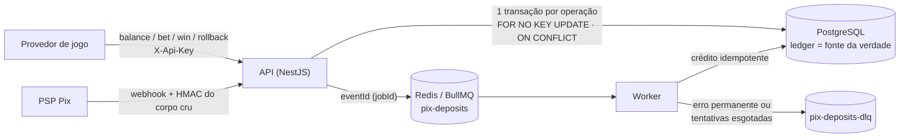
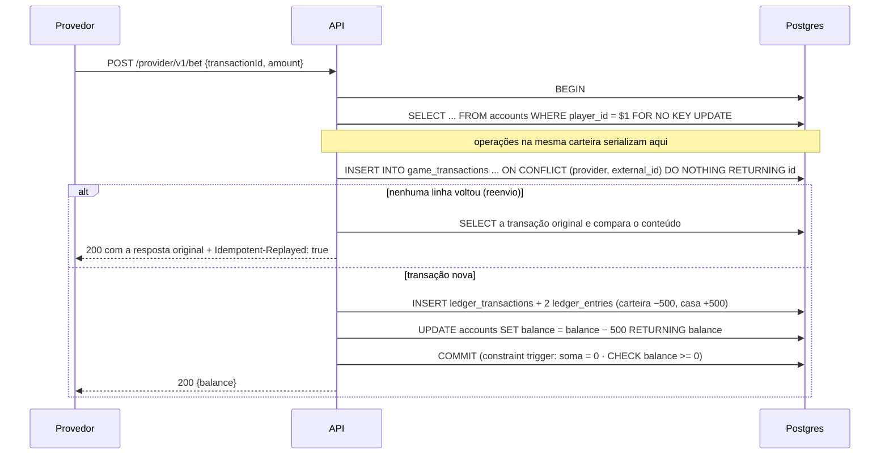
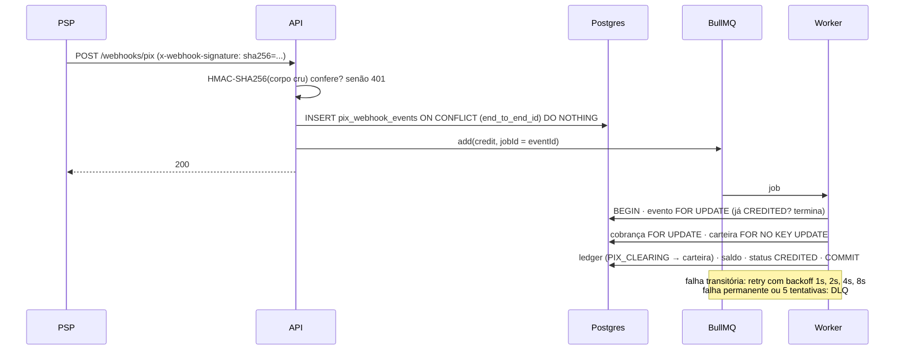
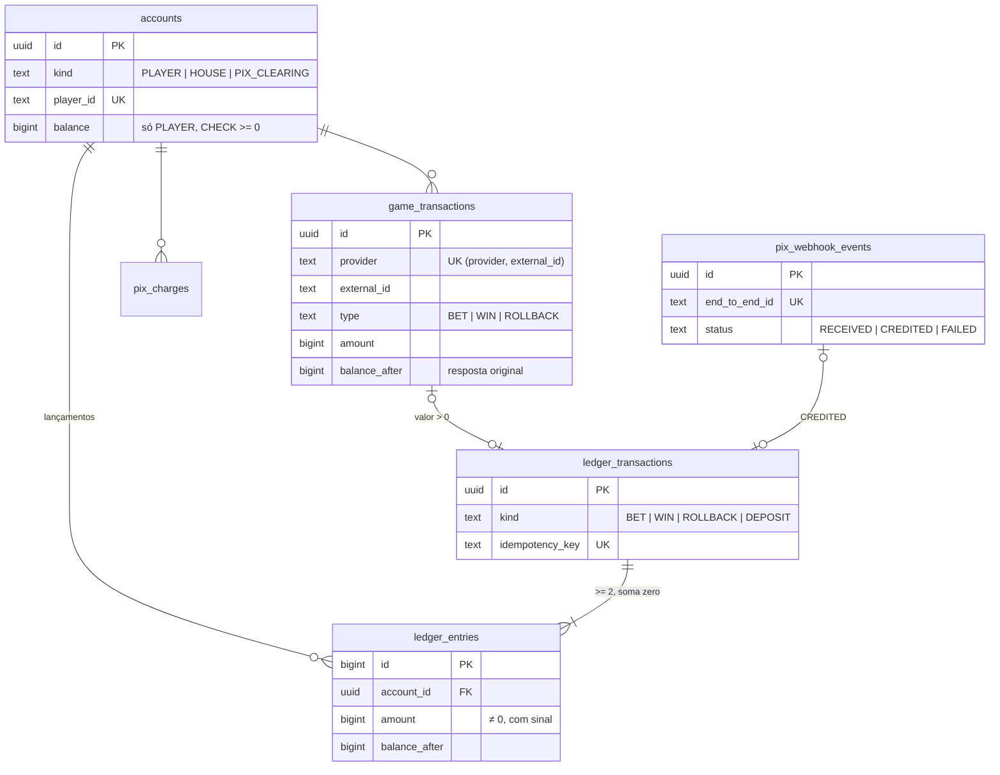

# Carteira iGaming (seamless wallet)

Backend de carteira para apostas no padrão **seamless wallet**: o provedor do jogo chama esta API
para consultar saldo, debitar a aposta, creditar o prêmio e estornar. O dinheiro entra por um
**depósito Pix simulado** (webhook assinado com HMAC, processado por fila).

O foco está nas partes em que esse tipo de sistema costuma quebrar: **dinheiro, concorrência e
idempotência**. Cada garantia tem um mecanismo no banco e um teste que a prova.

**Stack:** NestJS 11 · PostgreSQL 17 · Redis 7 + BullMQ · `pg` com SQL explícito · Jest · k6 · Docker Compose

---

## Rodando

```bash
docker compose up --build
```

| O quê | Onde |
|---|---|
| API | http://localhost:3000 |
| Swagger | http://localhost:3000/docs |
| Postgres | `localhost:55432` (wallet/wallet) |
| Redis | `localhost:56379` |

O compose sobe `postgres`, `redis`, `migrate` (aplica as migrações e sai), `api` e `worker`.
A API e o worker só sobem depois que a migração termina com sucesso.

> Se você usa contextos remotos do Docker (`docker context ls`), confira que o ativo é o local
> ou rode `docker --context default compose up --build`.

### Um passeio pela API

```bash
# 1. carteira do jogador
curl -s -X POST localhost:3000/wallets -H 'content-type: application/json' -d '{"playerId":"player-42"}'

# 2. cobrança Pix de R$ 100,00 (valores sempre em centavos)
TXID=$(curl -s -X POST localhost:3000/deposits/pix -H 'content-type: application/json' \
  -d '{"playerId":"player-42","amount":10000}' | jq -r .txid)

# 3. PSP simulado paga: monta o webhook, assina com HMAC e manda para /webhooks/pix
curl -s -X POST localhost:3000/dev/psp/pix/$TXID/pay -H 'content-type: application/json' -d '{}'

# 4. o provedor do jogo aposta R$ 5,00 e paga R$ 12,00 de prêmio
H='-H content-type:application/json -H x-api-key:dev-provider-key'
curl -s -X POST localhost:3000/provider/v1/bet $H \
  -d '{"transactionId":"tx-1","playerId":"player-42","roundId":"r-1","amount":500,"currency":"BRL"}'
curl -s -X POST localhost:3000/provider/v1/win $H \
  -d '{"transactionId":"tx-2","playerId":"player-42","roundId":"r-1","amount":1200,"currency":"BRL"}'

# 5. reenvie a mesma aposta: mesma resposta, header Idempotent-Replayed: true, nada debitado
curl -si -X POST localhost:3000/provider/v1/bet $H \
  -d '{"transactionId":"tx-1","playerId":"player-42","roundId":"r-1","amount":500,"currency":"BRL"}'

# 6. extrato (direto do ledger) e reconciliação
curl -s localhost:3000/wallets/player-42/statement
curl -s localhost:3000/admin/reconciliation
```

---

## Arquitetura



API e worker são **processos separados** com a mesma imagem: o crédito de Pix escala sozinho e
não disputa CPU com as apostas.

### Aposta (bet)



### Depósito Pix



### Modelo de dados



Schema completo, com os comentários: [migrations/001_init.sql](migrations/001_init.sql).

---

## Garantias e onde estão provadas

| Garantia | Mecanismo | Teste (e2e, Postgres e Redis reais) |
|---|---|---|
| O mesmo `transactionId` nunca debita duas vezes | `UNIQUE (provider, external_id)` + `INSERT ... ON CONFLICT DO NOTHING`, nunca "consulta e depois insere" | *a mesma aposta enviada 50 vezes ao mesmo tempo debita uma vez só* |
| Saldo exato e nunca negativo sob concorrência | lock da linha da carteira + checagem antes de escrever + `CHECK (balance >= 0)` | *200 apostas simultâneas terminam com saldo exato e nunca negativo* |
| Sem lost update | `FOR NO KEY UPDATE` + `UPDATE ... RETURNING` conferido contra o valor calculado | idem: cada aposta aceita vê um saldo diferente, em degraus exatos |
| Ledger é a fonte da verdade | saldo atualizado na mesma transação dos lançamentos; reconciliação | *carga aleatória e concorrente mantém soma do ledger = saldo* |
| Dupla entrada | constraint trigger **deferida**: no `COMMIT`, cada transação de ledger soma zero | *lançamento desbalanceado não passa do COMMIT* |
| Ledger imutável | triggers `BEFORE UPDATE/DELETE/TRUNCATE` | *ledger é append-only* |
| Webhook repetido = 1 crédito | `UNIQUE (end_to_end_id)` + `jobId = eventId` + evento travado no worker + chave `pix:<e2e>` única no ledger | *o mesmo webhook enviado 10 vezes gera um único crédito* |
| Webhook autêntico | HMAC-SHA256 sobre os **bytes crus**, comparado com `timingSafeEqual` | *assinatura inválida → 401*, *mesmo JSON com outra formatação não passa* |
| Falha permanente não fica em loop | `UnrecoverableError` → DLQ; reprocessamento manual | *txid desconhecido vai para a DLQ e pode ser reprocessado* |

---

## Decisões e trade-offs

**Lock pessimista, não otimista.** Numa carteira de apostas a contenção é a regra (um jogador
em slot rápido, rodadas com várias apostas, reenvios do provedor). Com lock otimista, cada
conflito vira retry na aplicação, e sob contenção os retries se acumulam. Com o lock de linha o
Postgres enfileira os escritores da carteira e cada um passa uma vez. Em carteiras diferentes não
há disputa nenhuma. O custo é que a vazão de **uma** carteira fica limitada pelo tempo da
transação (veja o cenário `hot_wallet` na seção de carga). `lock_timeout = 5s` evita espera
infinita: estourou, a resposta é `503 WALLET_BUSY` e o provedor reenvia (é idempotente).

**`FOR NO KEY UPDATE` em vez de `FOR UPDATE`.** É exatamente o lock que um `UPDATE` de coluna
não-chave pega. Ele serializa os escritores da carteira do mesmo jeito, mas não bloqueia o
`FOR KEY SHARE` que as foreign keys usam (por exemplo, criar uma cobrança Pix para o jogador
enquanto ele aposta).

**Ordem dentro da transação: travar → registrar → validar saldo → lançar.** O registro da
transação vem antes da checagem de saldo porque o reenvio de uma aposta que já passou precisa
devolver sucesso, mesmo que o saldo atual não cubra mais o valor. Aposta recusada por saldo
insuficiente faz `ROLLBACK` e não deixa rastro: um reenvio é reavaliado (e pode passar depois de
um depósito). Isso é deliberado: só fatos que movimentaram dinheiro viram registro imutável.

**Reenvio devolve a resposta original.** O saldo de resposta fica gravado em
`game_transactions.balance_after` e o reenvio devolve o mesmo corpo, com o header
`Idempotent-Replayed: true`. O mesmo `transactionId` com outro valor, jogador ou tipo é
`409 IDEMPOTENCY_CONFLICT`: é bug do provedor e não deve ser mascarado.

**Rollback antes da aposta.** Se o provedor tem timeout na aposta, ele pode mandar o rollback
antes de a aposta chegar. O rollback é registrado mesmo sem aposta (valor zero) e a aposta
atrasada é recusada com `409 TRANSACTION_ROLLED_BACK`. Um segundo rollback da mesma aposta
(outro id) bate num índice único parcial e vira `409 BET_ALREADY_ROLLED_BACK`.

**Contas de sistema sem saldo materializado.** A contrapartida de toda aposta é a conta `HOUSE`.
Se ela tivesse uma coluna de saldo, toda aposta de todo jogador precisaria travar a mesma linha,
e a carteira inteira viraria uma fila única. O saldo da casa é derivado (`SUM` do ledger) e a
reconciliação mostra o resultado. Só a carteira do jogador, que precisa de checagem de saldo
síncrona, tem saldo materializado.

**Dinheiro em centavos, `bigint`, nunca float.** No banco é `bigint`. O driver `pg` devolve
`bigint` como string e a aplicação converte para `BigInt` explicitamente. O `valor` do Pix
("110.00") é convertido por manipulação de string, sem `parseFloat`. Na API os centavos
trafegam como inteiros JSON, validados como inteiros seguros (até 2^53, ~R$ 90 trilhões);
fora disso a conversão falha em vez de arredondar.

**SQL explícito com `pg` em vez de ORM.** As garantias que importam (`ON CONFLICT`, lock de
linha, `CHECK`, triggers) são do Postgres. Com SQL explícito, o que está na revisão de código é
exatamente o que roda. Em TypeORM seria `setLock('pessimistic_write')`; no Prisma, SQL cru de
qualquer forma. As migrações são arquivos `.sql` aplicados por um migrador de ~60 linhas, com
`pg_advisory_lock` para que duas instâncias não migrem ao mesmo tempo.

**O banco como última linha de defesa.** Mesmo que a aplicação tenha um bug, o Postgres recusa
saldo negativo, ledger desbalanceado, `UPDATE`/`DELETE` no ledger e a mesma chave de negócio
lançada duas vezes. Os testes fazem essas violações com SQL direto e conferem que o banco recusa.

**Nunca uma segunda conexão dentro da transação.** A primeira versão buscava o id da conta da
casa pelo pool enquanto segurava o lock da carteira. Com 200 apostas simultâneas, as 20 conexões
do pool ficavam paradas esperando esse lock, e a transação que o segurava esperava uma 21ª
conexão que nunca vinha. Era um deadlock entre pool e lock, que só se desfazia no timeout de
conexão (4 apostas aceitas de 133). O teste de concorrência pegou o problema. Na correção, tudo
roda na conexão da transação, e o `LedgerService` nem recebe mais o pool.

**Webhook: gravar, enfileirar, responder.** O handler só valida, grava o evento e enfileira, e o
PSP recebe 200 rápido. Lentidão no ledger não vira timeout e reenvio em massa. A entrega da fila é
"pelo menos uma vez"; o consumidor é idempotente, então o efeito no saldo é "exatamente uma vez".
Se o evento for gravado e o enfileiramento falhar, a resposta é 503 e o reenvio do PSP
reenfileira o evento ainda `RECEIVED`.

**HMAC sem timestamp.** Um webhook capturado e reenviado não credita duas vezes (idempotência por
`endToEndId`), então replay não gera dinheiro. Em produção eu ainda acrescentaria timestamp
assinado com janela de tolerância e confirmaria o pagamento na API do PSP antes de creditar.

**Valor creditado é o valor recebido.** Se o Pix chega com valor diferente da cobrança, credita o
que entrou e registra a divergência (o dinheiro já está na conta).

**NestJS 11, não 12.** O Nest 12 virou ESM-only, o que complica Jest e exige Node ≥ 22.13 para o
`require(esm)`. Para um projeto deste tamanho o ganho não pagava o atrito.

---

## Testes

```bash
npm test                                   # unitários: dinheiro, HMAC, BR Code, config
docker compose up -d postgres redis
npm run test:e2e                           # e2e contra Postgres e Redis reais
```

São 29 testes unitários e 28 e2e. O e2e cria um database novo (`wallet_e2e`) a cada execução,
aplica as mesmas migrações de produção e usa o db 15 do Redis. API e worker sobem juntos, e os testes falam HTTP de verdade
(`fetch` numa porta aleatória), passando por guards, pipes e filtros.

| Suíte | O que prova |
|---|---|
| `concurrency` | 200 apostas simultâneas → saldo exato, nunca negativo, sem lost update; 50 reenvios simultâneos → 1 débito; carteiras em paralelo fecham a conta |
| `pix-deposit` | webhook 10× (simultâneo e depois sequencial) → 1 crédito; worker idempotente; HMAC sobre o corpo cru; DLQ e reprocessamento |
| `ledger-invariants` | 480 operações aleatórias (seed fixo) e concorrentes: soma do ledger = saldo, toda transação soma zero, cadeia de `balance_after` sem buracos; o banco recusa violações feitas por fora da aplicação |
| `provider-wallet` | contrato do provedor: autenticação, idempotência, conflito, saldo insuficiente, moeda, rollback (idempotente, duplicado, antecipado, de outro jogador) |

---

## Carga (k6)

```bash
docker compose --profile load run --rm k6
```

O script ([load/bets.js](load/bets.js)) cria 100 carteiras, deposita nelas pelo fluxo Pix real e
roda dois cenários de 30s com 50 usuários virtuais:

- **`spread`**: apostas espalhadas pelas 100 carteiras (o caso normal);
- **`hot_wallet`**: todas as apostas na mesma carteira, o pior caso para o lock pessimista.

<!-- resultados-k6 -->
Medido em 10/11/2026 com tudo na mesma máquina (16 vCPUs, WSL2 + Docker): o k6, **uma** instância
da API (um processo Node), o worker, Postgres 17 e Redis 7. Pool de 20 conexões, 50 VUs, 30 s por
cenário.

| Cenário | Apostas | Apostas/s | p50 | p95 | p99 | Erros |
|---|---:|---:|---:|---:|---:|---:|
| `spread` (100 carteiras) | 35.923 | **~1.200** | 40 ms | **55 ms** | 66 ms | 0% |
| `hot_wallet` (1 carteira) | 10.411 | **~350** | 113 ms | **195 ms** | 1.021 ms | 0% |

Depois da carga havia 46.336 transações de jogo e 92.874 lançamentos, e `GET /admin/reconciliation`
respondeu `ok: true`: saldo = soma do ledger nas 101 carteiras, toda transação somando zero, soma
global zero, nenhuma carteira negativa.

Como ler:

- **`spread`**: carteiras diferentes não disputam lock, então o limite aqui é a própria API (um
  processo Node fazendo ~8 consultas por aposta). Isso escala com mais instâncias.
- **`hot_wallet`**: ~350 apostas/s ≈ 2,9 ms por aposta, que é o tempo que cada transação segura o
  lock da carteira (as idas e voltas ao banco mais o `COMMIT` com fsync). É o teto de **uma**
  carteira com lock pessimista, e mais instâncias não o aumentam: o caminho é segurar o lock por
  menos tempo (veja os próximos passos). Um jogador humano não chega perto de 350 apostas/s; o
  cenário existe para mostrar onde fica o teto.
- O **p99 de ~1 s** no `hot_wallet` é a cauda dessa fila: 50 clientes disputando uma linha, com as
  20 conexões do pool paradas no lock. Não investiguei a distribuição a fundo; é o primeiro lugar
  para olhar se esse cenário importar.
<!-- /resultados-k6 -->

---

## Estrutura

```
src/
  ledger/      LedgerService (único que escreve saldo/ledger), reconciliação
  provider/    seamless wallet: balance, bet, win, rollback
  pix/         cobrança, webhook HMAC, worker BullMQ, DLQ, PSP simulado (dev)
  wallet/      criação, saldo e extrato
  database/    pool, transação, migrador SQL
migrations/    schema com constraints e triggers
test/e2e/      suítes contra Postgres e Redis reais
load/          script k6
```

## Limitações e próximos passos

- **Autenticação** nos endpoints de carteira e admin (hoje só o provedor e o webhook autenticam).
- **Segurar o lock por menos tempo**: hoje uma aposta faz várias idas e voltas ao banco com a carteira travada. Uma função PL/pgSQL que trava, registra, lança e atualiza o saldo numa chamada só subiria o teto do `hot_wallet`.
- **Carteira quente ocupando o pool**: no `hot_wallet`, as 20 conexões ficam paradas no lock de uma carteira, e apostas de outras carteiras esperam conexão. Saídas: uma fila por carteira em memória antes de pegar a conexão (um escritor por carteira por instância) ou um pool separado.
- **Varredura de eventos parados**: um job periódico que reenfileira eventos `RECEIVED` antigos, para o caso de o PSP desistir de reenviar.
- **Sessão de jogo**: provedores reais identificam o jogador por token de sessão, não por `playerId`.
- **Escala da conta da casa**: em volume alto, a FK de `ledger_entries` para a linha `HOUSE` gera contenção de *multixact* (`FOR KEY SHARE` de muitas transações). Saídas: sub-contas da casa por shard ou remover a FK só para contas de sistema.
- **Particionar `ledger_entries`** por tempo quando o volume crescer.
- **Observabilidade**: métricas (latência por operação, profundidade da fila, DLQ) e tracing.
